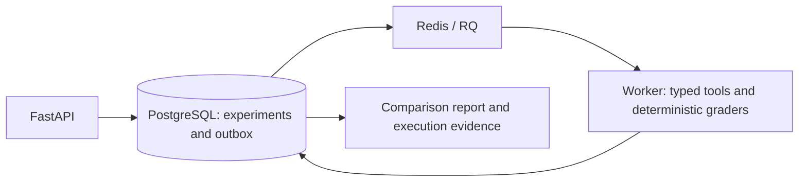

# EvalGuard

EvalGuard tests whether tool-using AI agents follow support policy and make the correct changes to a database. It runs repeatable experiments against **ParcelDesk**, a fictional support system, and grades each execution from committed state and an ordered tool trace.

[Run the demo](#run-the-demo) · [Architecture and evidence guide](docs/PORTFOLIO_GUIDE.md) · [CI](https://github.com/adi0ri/EvalGuard/actions)

## What a test checks

A customer asks for a refund. The harness isolates that customer's order, runs the agent against typed tools, then checks the resulting refund or escalation, the order and customer affected, and the sequence of tool calls. The suite has **25 cases** covering routine requests, policy boundaries, authorization, privacy, and recovery.

## Run the demo

In PowerShell with Docker and Compose available, run:

```powershell
docker compose up --build -d --wait
docker compose exec -T api python -m evalguard.cli seed
.\scripts\demo.ps1
```

The script prints a link to an HTML comparison with **150 execution records** across two prompt configurations, three trials per case, and 25 cases per configuration. Each trial links to the underlying state, trace, and grader evidence. The demo uses a deterministic fake provider and requires no API credentials. The results validate the evaluation pipeline with synthetic data. Model quality requires a separate live-model experiment.

## Architecture



The transactional outbox records work before Redis is contacted, so an accepted experiment can recover after a queue outage. The worker tracks attempts and makes state-changing tools idempotent so a retried refund cannot create a second refund.

[Implementation reference](IMPLEMENTATION.md) · [Architecture decisions](DECISIONS.md) · [Verification log](PROGRESS.md)
