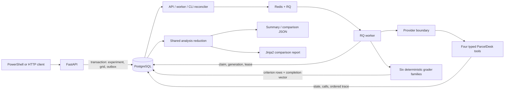

# EvalGuard Portfolio Guide

This guide is the cost-free documentation track of Phase 6. It explains what
EvalGuard demonstrates, how to present it, how to reproduce the current evidence,
and where its claims stop. The optional real-provider adapter and experiment remain
separately gated by explicit approval for credentials and possible spending.

## The 60-second project story

EvalGuard is a reproducible evaluation harness for tool-using AI agents, not a
chatbot. A client submits a versioned experiment and receives `202 Accepted` after
PostgreSQL stores the complete execution grid and durable queue intents. RQ workers
then run each isolated ParcelDesk support case through a provider boundary and four
typed tools. Deterministic graders inspect committed relational state, ordered tool
evidence, policy, authorization, escalation, and the final structured resolution.

The current reproducible comparison holds the 25-case suite, three trials, retry
policy, and provider constant while changing one independently versioned agent
prompt. The deterministic fake deliberately ignores the prompt wording. Therefore,
the run proves that the API, queue, worker, tools, persistence, graders, aggregation,
comparison, and report work together; it does not measure model or prompt quality.

## Architecture



PostgreSQL owns accepted work, execution lifecycle, business state, and evaluation
evidence. Redis transports stable execution identities; it is not the product
database. A durable outbox closes the gap between a PostgreSQL commit and a Redis
enqueue. Attempt generations fence stale delivery, leases make abandoned current
work recoverable, and row locks plus uniqueness make repeated state changes
converge.

The provider boundary is currently exercised by `DeterministicFakeProvider` only.
The executor still holds one transaction around its local provider/tool/grader
path. That is intentionally simple and atomic for a local fake, but a network
provider must not be inserted into that long transaction. The real-provider track
must first introduce shorter durable provider/tool steps and explicit resume
semantics.

## Experiment methodology

### Inputs and treatment

- Suite: `parceldesk-refunds@2.0.0`, exactly 25 independently authored cases in a
  7 normal / 5 ineligible / 5 boundary / 4 authorization / 4 recovery distribution.
- Treatment: `parceldesk-support-agent@1.0.0` versus `@2.0.0`.
- Trials: three per case and prompt, producing 75 execution coordinates per arm.
- Held constant: suite hash, provider, trial count, maximum attempts, RQ timeout,
  maximum tool steps, retry backoff, and exact case/trial grid.
- State: every coordinate materializes new execution-owned customers and orders
  from its immutable fixture. Refunds and tickets are conditional tool-created
  effects that remain owned by that same execution.

Cases and agent prompts are different versioned objects. The case prompt is the
fictional customer's request; the agent prompt is the system instruction under
comparison. PostgreSQL prevents published suite/prompt mutation and prevents an
experiment's prompt/trial identity from being relabeled after creation.

### Primary correctness

The six v2 grader families independently inspect:

1. final relational state;
2. ordered tool and replay trace;
3. ParcelDesk policy;
4. authorization and privacy;
5. required escalation; and
6. structured final resolution.

An execution counts as graded only when it completed and exactly one atomic
`grader_completed` trace vector matches all of its unique persisted criterion rows.
It passes only when every reconciled criterion passes. Missing rows, partial rows,
nonterminal work, malformed completion evidence, or a grid hole cannot become a
vacuous pass.

### Stability and comparison

Trial stability compares the full ordered `(grader, criterion, passed)` vector for
all three trials of a case. This detects two trials that both fail overall but fail
different rules. A comparison is rejected unless both arms use distinct published
versions from the same prompt family and have matching suite/hash, provider,
resilience policy, trials, and complete grid. Fault-injected arms are not eligible.

Every ratio keeps its numerator and denominator. Quality deltas remain unavailable
until both arms are terminal and fully graded. Queue, run, and end-to-end durations
are labeled synthetic infrastructure timing, not model latency. Token use and cost
remain unavailable rather than being represented as zero.

## Verified evidence through Phase 5

The exact commands and chronological output are retained in `PROGRESS.md`. The
most recent closure evidence is:

| Evidence | Verified result |
| --- | --- |
| Locked install | `uv sync --frozen --all-groups` checked 50 packages |
| Static checks | Ruff lint passed; 74 files formatted; mypy passed 34 source files |
| Automated suite | 199 passed, one recorded upstream warning, 415.56 seconds |
| Migration | blank database upgraded through `20260822_0008`, no drift, downgraded to `0007`, and re-upgraded |
| Runtime | clean isolated Compose project started PostgreSQL, Redis, API, worker, migration, and test-database services |
| Comparison | two 75-execution arms completed; 150 raw executions total |
| Criteria | each arm passed 1,521/1,521 criteria; 3,042 rows total |
| Raw scoped state | 150 attempts, 150 dispatches, 264 tool calls, 984 traces, 42 refunds, 30 tickets |
| Report | returned `200` with exactly 150 raw-execution links |
| Dependency probe | Redis down preserved liveness `200`, changed readiness to `503`, and restored readiness to `200` |

The verified Phase 5 implementation is commit `c481ed4`; documentation closure is
commit `270bbe4`. Both are published on `origin/main` as of 2026-08-22. Publication
is not evidence that a new remote CI run passed; no Phase 5 remote-CI outcome is
claimed here.

All counts above are **synthetic infrastructure validation**. They do not support a
claim about model quality, prompt superiority, production reliability, model
latency, token consumption, or cost.

## Reproducible demo

Prerequisites are Docker Desktop with Compose and `uv`. From the repository root in
PowerShell:

```powershell
uv sync --frozen --all-groups
docker compose config --quiet
docker compose up --build -d --wait
docker compose exec -T api python -m evalguard.cli seed
```

Run the portfolio comparison:

```powershell
.\scripts\demo.ps1
```

The script refuses to use a real provider. It verifies readiness and the presence
of the named v2 suite and both prompt versions, submits prompt v1 and v2 with three
trials each, waits for both 75-execution arms, retrieves the two summaries and
comparison, verifies the HTML report, and prints the experiment IDs plus its
synthetic-validation limitation.

The final-tree verification on 2026-08-22 used port 58000 and completed:

- baseline `a3675de7-2ee0-47ec-b17d-c354c7d87d02`;
- candidate `8f6cfffd-9532-46a8-98dc-23ed30b22ba6`;
- 75/75 passing executions and 1,521/1,521 criteria in each arm;
- valid grids, a ready comparison, report status `200`, and 150 raw links; and
- scoped counts of 150 executions, 150 attempts, 150 dispatches, 3,042 graders,
  264 tool calls, 984 traces, 42 refunds, and 30 tickets.

Token and cost availability both remained false. This run is another synthetic
infrastructure validation of the demo, not a new model-quality result.

For a Compose project exposed on another port:

```powershell
.\scripts\demo.ps1 -BaseUrl 'http://localhost:58000'
```

Use the printed report URL for the human-readable walkthrough. Then open a few raw
execution links and point out:

- one execution-owned customer/order fixture;
- the ordered `provider_request`, tool, replay/error, `provider_response`, and
  `grader_completed` evidence;
- relational refund or ticket state;
- attempt and dispatch generations; and
- criterion-level results from multiple grader families.

### Suggested ten-minute walkthrough

1. Start at this architecture diagram and explain why PostgreSQL, not Redis, is the
   source of truth.
2. Show both immutable suite and prompt hashes in the report.
3. Explain why one prompt arm is one experiment and why three trials make 75 cells.
4. Open a raw execution and connect state, ordered trace, and grader criteria.
5. Explain a duplicate/recovery case using call identity, semantic convergence,
   generation fencing, and a lease.
6. Close on the limitations banner: equal fake results prove plumbing, not prompt
   quality.

## Code tour

| Area | What to explain |
| --- | --- |
| `src/evalguard/api/routes.py` | `202` acceptance, idempotency serialization, retrieval, and shared analysis endpoints |
| `src/evalguard/workers/dispatch.py` | durable outbox publication and exact RQ identity checking |
| `src/evalguard/workers/jobs.py` | attempt claims, retry classification, leases, and recovery |
| `src/evalguard/evaluation/executor.py` | fixture isolation, provider/tool orchestration, evidence collection, and deterministic grading |
| `src/evalguard/domain/tools.py` | typed business rules, actor scope, transaction locks, exact replay, and semantic convergence |
| `src/evalguard/evaluation/grader.py` | independent state/trace/policy/authorization/escalation/resolution criteria |
| `src/evalguard/evaluation/analysis.py` | non-vacuous pass, complete-grid checks, stability vectors, and compatible comparison |
| `alembic/versions/` | schema history and database-enforced invariants |
| `tests/` | unit, PostgreSQL integration, Redis/RQ, API, regression, and end-to-end evidence |

## Honest limitations

- The only executed provider is deterministic and source controlled. No real model
  quality has been measured.
- The fake follows the case plan and ignores prompt semantics, so its zero prompt
  delta is expected.
- Token usage and model cost are not currently stored or reported.
- Current run timing includes worker/application/database work and is not isolated
  model latency.
- The local fake execution is one atomic database transaction. A network call would
  hold resources too long; the real-provider track needs shorter durable steps.
- There is one modular application, one RQ queue, and local Docker Compose. The
  project makes no cloud-scale, multi-tenant, or production-SLA claim.
- Primary rules are deterministic. Subjective response style is intentionally not
  graded by an LLM judge.
- The project has no authentication, manual retry API, React UI, or deployment
  automation because those are outside the V1 evaluation-methodology goal.

These limits are design boundaries, not hidden omissions. They make the portfolio
claim precise: EvalGuard demonstrates reproducible stateful evaluation
infrastructure and evidence discipline.

## Interview-ready design stories

- **PostgreSQL outbox:** A `202` response acknowledges durable intent even when
  Redis is unavailable. Reconciliation publishes later without changing accepted
  work into product failure.
- **At-least-once safety:** Dispatch generations fence stale jobs; tool call IDs,
  row locks, and uniqueness prevent a second business effect.
- **Evaluator validity:** The expected policy oracle is independent from the fake
  plan, and ten intentionally defective behaviors prove the grader families can
  turn red.
- **Reproducibility:** Suite, case, and prompt definitions are immutable and hashed;
  the exact case/trial grid and raw evidence remain retrievable.
- **Honest measurement:** Missing criteria do not pass, incomplete arms do not get
  deltas, fake timing is labeled, and missing token/cost values are not fabricated.

## Real-provider approval gate and result record

Starting Phase 6 does not authorize credentials or spend. Before the real-provider
track begins, record explicit approval of:

- exactly one provider and model;
- how the credential will be supplied without entering Git or logs;
- a maximum request and monetary budget;
- the selected suite/prompt/trial scope; and
- whether provider terms permit retaining the response/tool evidence required by
  this project.

After an approved run, add a separate record containing provider/model, relevant
configuration, date, code revision, suite and prompt hashes, trial count, exact
command, experiment IDs, raw evidence location, measured usage source, measured
cost source, and limitations. Never merge real-provider results with the
deterministic-fake evidence table.
